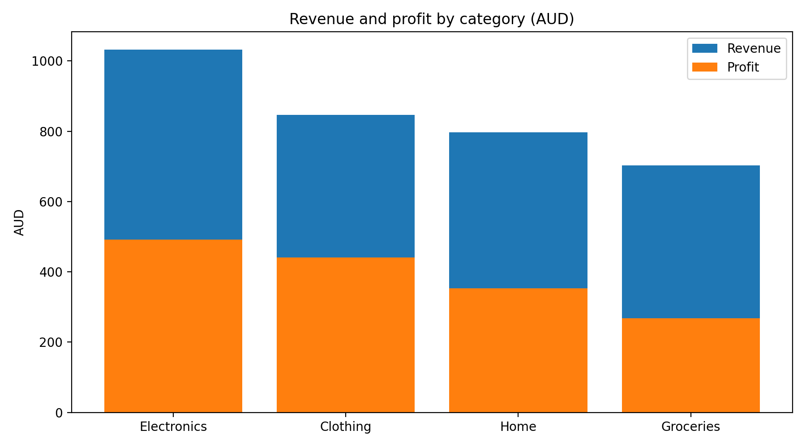
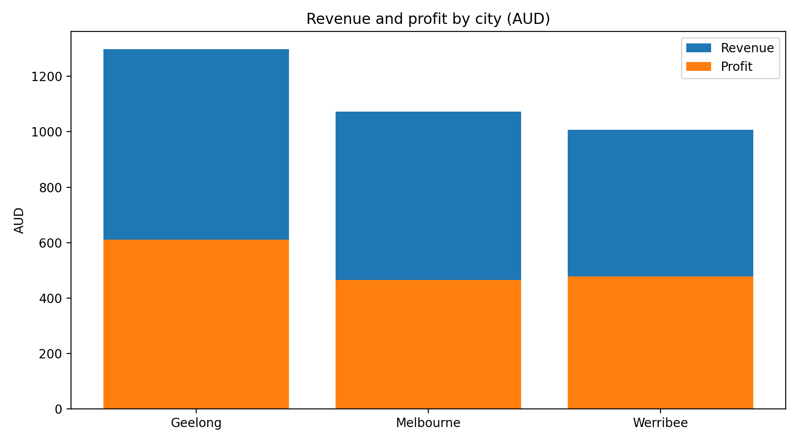
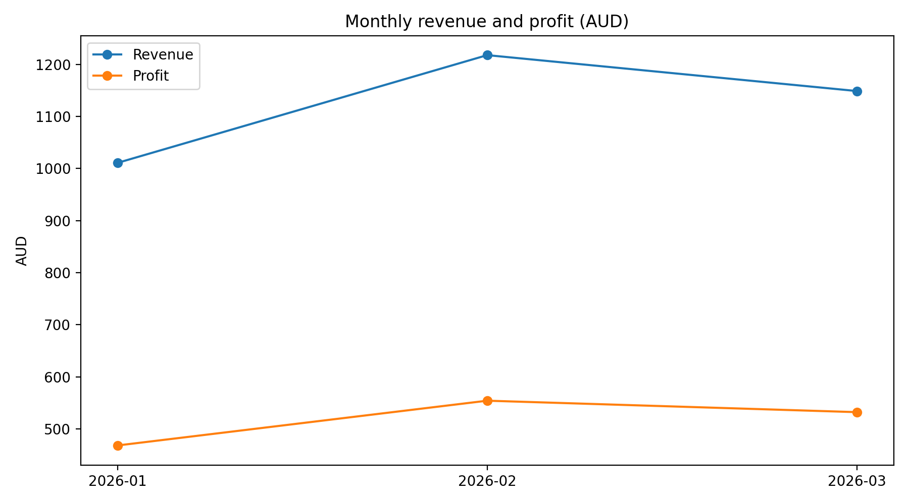

# Retail Sales Analysis — My Individual Portfolio Project

I built this project to practise the full data analyst workflow: cleaning and checking data, summarising it in Excel, SQL, and Python, and writing findings I can explain in an interview.

I used a fictional, synthetic retail dataset from January to March 2026, with 40 records. These are practice results, not real business performance.

## What I found
I verified these numbers myself from the CSV:
- Total revenue: AUD 3,378
- Total cost: AUD 1,824
- Total profit: AUD 1,554
- Units sold: 199
- Overall profit margin: 46.0%
- Top revenue category: Electronics (AUD 1,032)
- Top margin category: Clothing (52.1%)
- Top revenue city: Geelong (AUD 1,298)
- Peak month: February 2026 (AUD 1,218)

I wrote the full findings, recommendations, and limitations in `insights/analysis_notes.md` and in `Retail_Sales_Analysis_Report.docx`.

One finding I would highlight in an interview: revenue rank and margin rank are different. Electronics earns the most revenue, but Clothing earns the most profit per dollar of sales. I also found that the highest-volume products and cities are not always the highest-revenue ones, which is why I report units and revenue separately.

## Files in this folder
- `data/retail_sales.csv` — the synthetic dataset I worked with
- `sql/analysis_queries.sql` — my 9 analysis queries
- `python/analyze_sales.py` — my pandas analysis
- `retail_sales_analysis.xlsx` — my Excel workbook, with Data, By Category, By City, Monthly, and By Product sheets, plus charts
- `charts/` — my charts for category, city, and monthly trends
- `outputs/` — my category, city, product, and monthly summary tables
- `Retail_Sales_Analysis_Report.docx` — my final report

## Open these files first
- `retail_sales_analysis.xlsx` — Excel workbook, with Data, By Category, By City, Monthly, and By Product sheets, plus charts
- `sql/analysis_queries.sql` — 9 SQL queries for overall, category, city, product, monthly and margin analysis
- `python/retail_sales_analysis.ipynb` — Python notebook, with data checks, totals, and category, city, monthly and product tables
- `python/analyze_sales.py` — Python script version of the same analysis
- `dashboard/retail_dashboard.html` — interactive dashboard, click a category to filter the product table, plus a Power BI rebuild guide in `dashboard/README.md`

## Screenshots and results

Key results, verified from the CSV: revenue AUD 3,378, cost AUD 1,824, profit AUD 1,554, units 199, margin 46.0%. By category, Electronics AUD 1,032 revenue, Clothing AUD 846 revenue at 52.1% margin, Home AUD 797, Groceries AUD 703. By city, Geelong AUD 1,298, Melbourne AUD 1,073, Werribee AUD 1,007. By month, January AUD 1,011, February AUD 1,218, March AUD 1,149.
